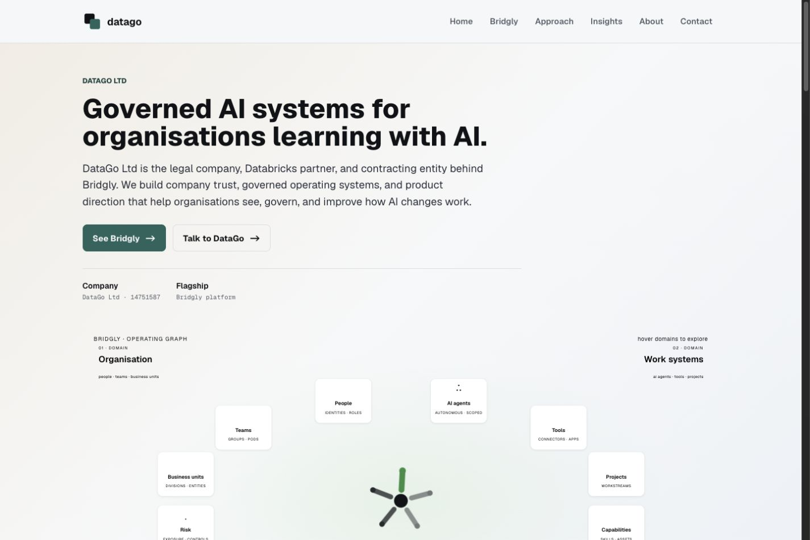
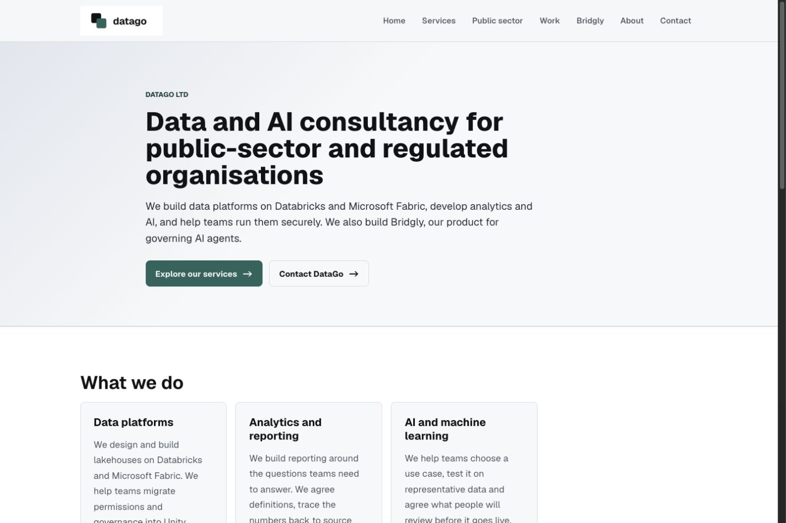
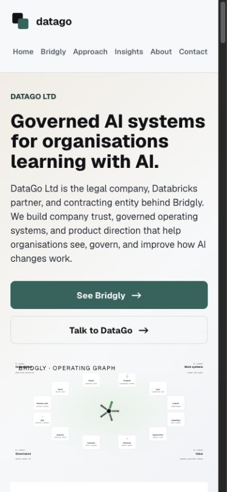
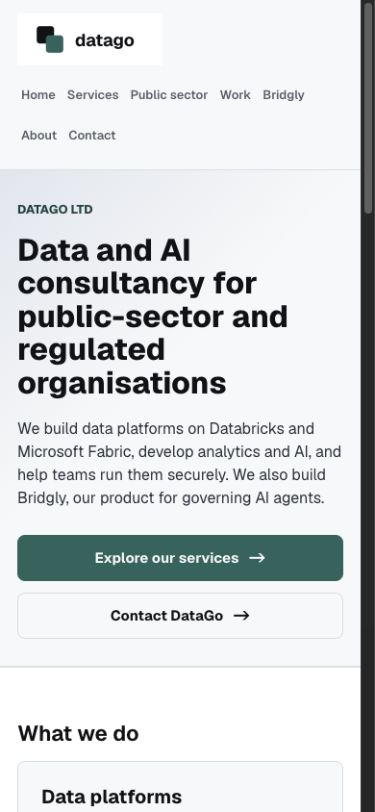

# DataGo facelift review

## Company details to confirm before release

- [CONFIRM: Dale Harrison as founder, final 80-word bio and photo or decision to omit photo]
- [CONFIRM: years delivering data and AI work and types of organisation served]
- [CONFIRM: Databricks partner status and tier, Microsoft partner status and individual Databricks, Fabric and Azure certifications]
- [CONFIRM: Cyber Essentials or Cyber Essentials Plus and certificate date if issued]
- [CONFIRM: ISO 27001 status]
- [CONFIRM: Digital Marketplace listings and lots, including G-Cloud and Digital Outcomes and Specialists]
- [CONFIRM: Central Digital Platform supplier registration]
- [CONFIRM: staff clearance capability, including BPSS or SC]
- [CONFIRM: professional indemnity, public liability and employer’s liability insurance amounts]
- [CONFIRM: ICO registration number]
- [CONFIRM: VAT registration number]
- [CONFIRM: social value statement]
- [CONFIRM: public contact email. The site currently uses info@datago.uk]

## Work page material

**NEEDS CLIENT CLEARANCE** · [CONFIRM: anonymised UK public-sector data platform or master data management story, scope, DataGo’s contribution and evidence of outcome]

**NEEDS CLIENT CLEARANCE** · [CONFIRM: anonymised UK public-sector analytics or secure operations story, scope, DataGo’s contribution and evidence of outcome]

## Product page material

[CONFIRM: approved current Bridgly screenshot from the fictional BridgeRock demo. Caption it “BridgeRock Property Solutions, a fictional company used to demonstrate Bridgly.”]

## Accessibility statement

[CONFIRM: assessment date, scope and any known accessibility issues before publication]

## Search and LinkedIn

The bare “DataGo” search returns several similarly named companies. datago.uk appears for a more specific company query. The existing LinkedIn page at /company/datago-uk/ was renamed Bridgly and uses the Bridgly logo. Restore the DataGo name, logo and company website on that existing page. After the site goes live, verify the live homepage and sitemap in Google Search Console and Bing Webmaster Tools and request a refresh where available.

## Homepage screenshots

| Width | Live before | Branch after |
| --- | --- | --- |
| Desktop |  |  |
| Phone |  |  |
